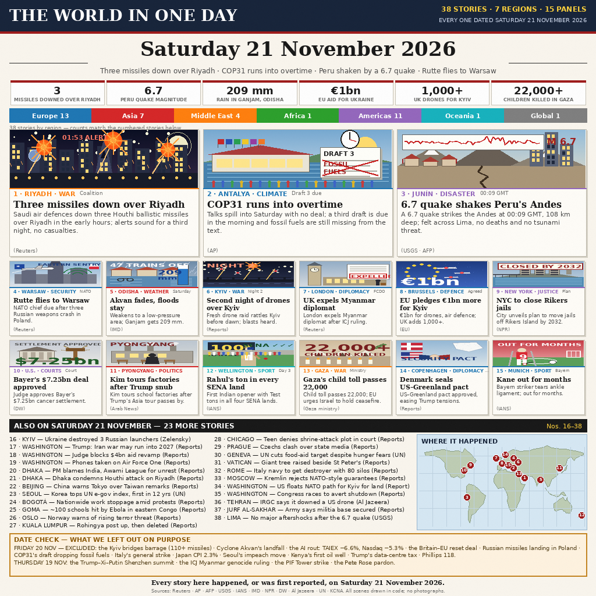

# The World in One Day — Saturday 21 November 2026

[](https://make.fun/bounty/news-image-20261121?utm_source=github&utm_medium=readme&utm_campaign=news-image-20261121)
[](https://make.fun/bounty/news-image-20261121/leaderboard?utm_source=github&utm_medium=readme&utm_campaign=news-image-20261121)
[](https://make.fun/bounty/news-image-20261121?utm_source=github&utm_medium=readme&utm_campaign=news-image-20261121)

One image, one day: a 1024×1024 newspaper front page summing up
**Saturday 21 November 2026** in **38 verified stories** across 7 regions —
15 code-drawn panels, a 6-figure number strip, a world map with numbered
pins, 23 more stories in brief, and a DATE CHECK box that names Friday's
big news (Kyiv bridges barrage, Cyclone Akvan's landfall, the AI rout)
as deliberately excluded. Every story happened, or was first reported,
on Saturday 21 November 2026.

Lead story: Saudi air defences down three Houthi ballistic missiles over
Riyadh in the early hours of Saturday (Reuters). Also leading: COP31 runs
into overtime in Antalya, and a magnitude 6.7 quake shakes Peru's Andes
at 00:09 GMT.



## Run it

```sh
python3 render.py   # renders entry.png (PIL; deterministic)
node main.ts        # validates entry.png and copies it to
                    # $MAKEFUN_OUTPUT_DIR (default: this repo dir)
```

`render.py` is the whole front page: layout, 15 drawn scenes, map, briefs
and date check, all in code — no photographs. `main.ts` gates the PNG
(PNG, ≤ 1 MiB, ≤ 1024×1024, intact IEND) and verifies the copy
byte-for-byte.

## Sources

Reuters, AP, AFP, USGS, IANS, IMD, NPR, DW, Al Jazeera, UN, KCNA.
Each panel and brief carries its source on the page.

<sub>Entered on [make.fun](https://make.fun/?ref=1c6x9h9j&utm_source=github&utm_medium=readme&utm_campaign=news-image-20261121)</sub>
